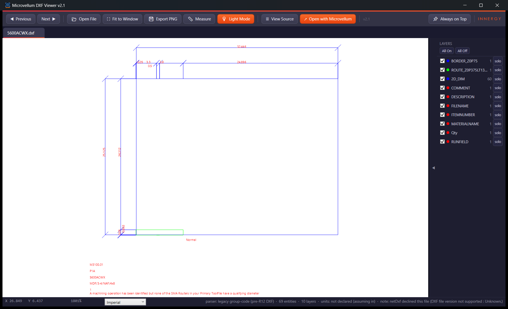
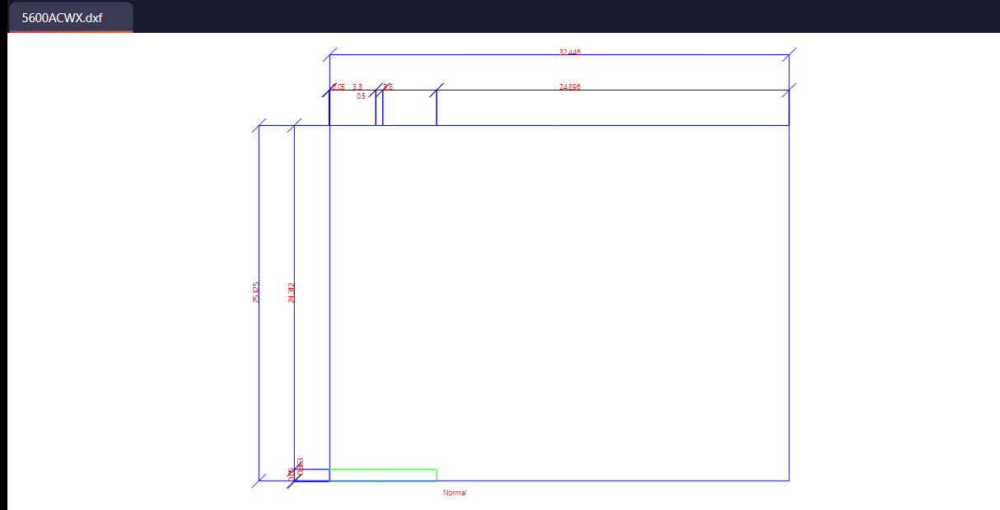
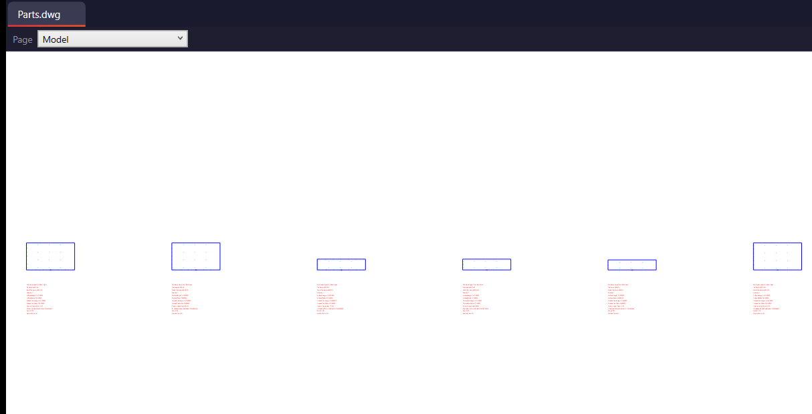
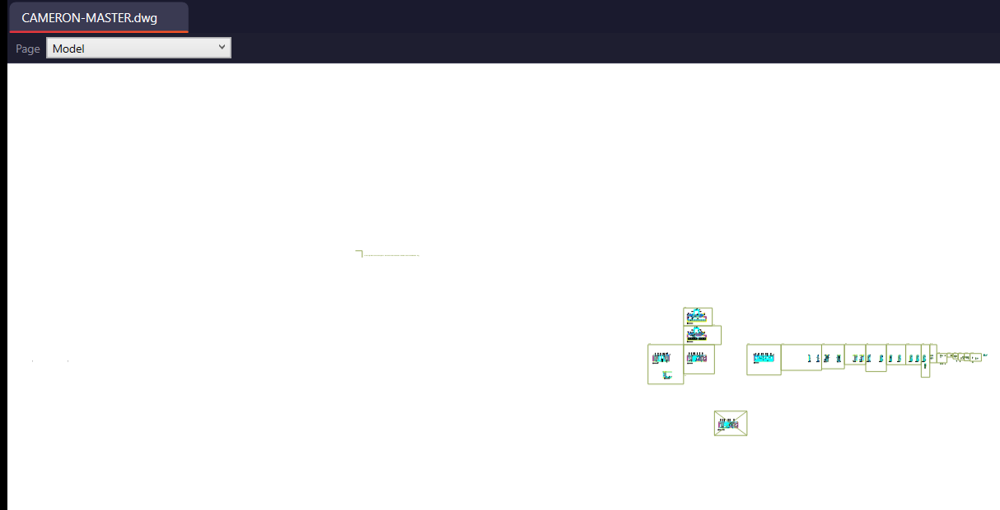
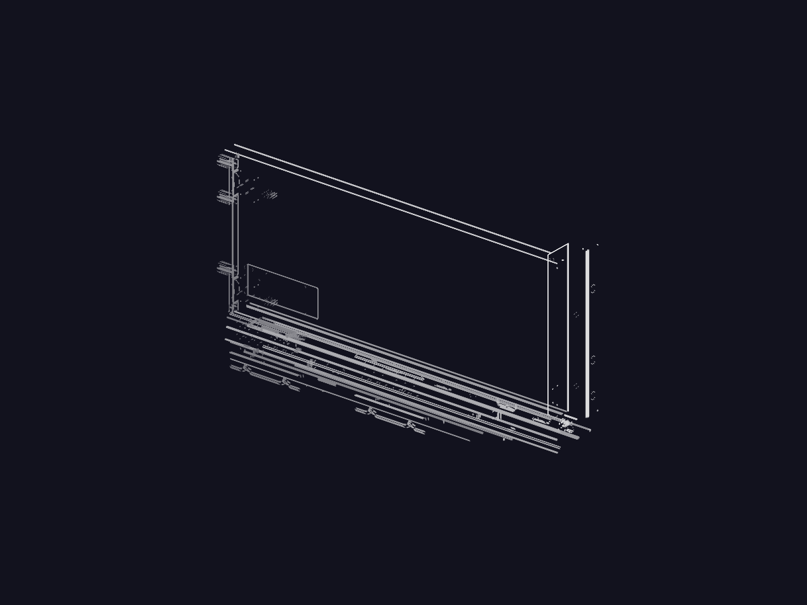

# Microvellum DXF Viewer

**Walk a whole work order's drawings with the arrow keys. No CAD seat required.**

[](https://github.com/granterogers/dxf-viewer/actions/workflows/build.yml)


A Microvellum work order drops dozens of DXF files into one folder. Checking them used to
mean opening CAD, waiting, looking at one part, closing it, and repeating. This opens any
one of them in about a fifth of a second and lets you step through the rest with the arrow
keys.



---

## Why it exists

When a part comes off the machine wrong, there is exactly one question: is the machine
wrong, or is the export wrong?

Answering it shouldn't require a CAD licence, a two minute load, and a seat that someone
else on the floor is waiting for. It should take a glance.

| | Before | With the viewer |
|---|---|---|
| Open one part | Launch CAD, wait, open | **~0.2s** |
| Check the next 30 | Repeat, 30 times | Hold <kbd>→</kbd> |
| Seats tied up | One per person looking | Zero |
| Reading the raw group codes | Export, or guess | One button |

Those timings are measured, not estimated. A typical cutlist part parses and renders in
**185 to 200 ms**. The heaviest drawing in the test corpus, 7,800 lines across 21 layout
sheets, takes **two seconds**. All 332 sample drawings parse in **seven**.

## What makes it accurate

Plenty of viewers will draw a DXF. The point of this one is that it draws it *the way
Microvellum does*, so a side by side comparison means something.

Microvellum recolours cutlist layers regardless of the colour stored in the file. So does
this. `BORDER` layers render blue, `ROUTE` layers green, and `2D_DIM` splits in two: the
dimension lines blue, the value text red. Without that, a part whose border is stored as
plain white looks nothing like the drawing you're checking it against.



## What it does

**Reads DXF and DWG natively.** No ODA converter, no intermediate step, nothing to install
alongside it. Modern DXF goes through netDxf; the headerless pre-R12 files that most real
cutlist exports actually are go through a dedicated group-code reader.

**Opens files other applications are holding.** The viewer never writes, so it never asks
for exclusive access. A drawing already open in Microvellum still opens here.

**Measures.** Two clicks for a distance with dX and dY, updating live as the cursor moves
and snapping to endpoints and circle centres. Imperial, metric, or raw drawing units.

**Inspects.** Click any entity for its type, layer, coordinates, and length or radius.

**Tells you what it skipped.** The status bar names the parser that ran, the entity and
layer counts, and any entity type it could not draw, so "nothing there" is never confused
with "not supported".

<table>
<tr>
<td width="50%"><br><sub><b>Nesting sheets.</b> Lines stay one pixel thin at any zoom, so a full sheet reads and a single boring stays crisp.</sub></td>
<td width="50%"><br><sub><b>Layout tabs.</b> A DWG's Paper Space sheets become selectable pages. One bedroom drawing opens as 21.</sub></td>
</tr>
<tr>
<td width="50%"><br><sub><b>3D bodies.</b> DWGs with solid bodies open in an orbit view. Drag to rotate, wheel to zoom, with far edges depth-cued.</sub></td>
<td width="50%" valign="top"><br><sub><b>Also included:</b> tabbed files, drag and drop, PNG export, light and dark drawing backgrounds, per-layer entity counts with solo, always-on-top, an icon-only toolbar mode, and a tray icon that keeps it out of the way.</sub></td>
</tr>
</table>

## Install

### Download and run

Grab the latest release, unzip anywhere, and double-click `DxfViewer.exe`. It is a
self-contained build: the .NET runtime is inside the executable, so there is nothing to
install first.

Windows SmartScreen will warn on first run because the build is not code-signed. Choose
**More info**, then **Run anyway**.

### Build from source

```bash
git clone https://github.com/granterogers/dxf-viewer.git
cd dxf-viewer
dotnet build -c Release
```

Requires the [.NET 8 SDK](https://dotnet.microsoft.com/download/dotnet/8.0). To produce the
standalone single-file build:

```bash
dotnet publish -c Release -r win-x64 --self-contained true \
  -p:PublishSingleFile=true -p:IncludeNativeLibrariesForSelfExtract=true
```

## Keyboard

| Key | Action |
|---|---|
| <kbd>←</kbd> <kbd>→</kbd> | Previous / next drawing in the folder, wrapping at both ends |
| <kbd>F</kbd> | Fit the drawing to the window |
| <kbd>Ctrl</kbd>+<kbd>O</kbd> | Open a file |
| <kbd>Ctrl</kbd>+<kbd>W</kbd> | Close the current tab |
| <kbd>Ctrl</kbd>+<kbd>Tab</kbd> | Next tab (add <kbd>Shift</kbd> for previous) |

Drag a `.dxf` or `.dwg` onto the window, or pass one on the command line.

## Known limits

Stated plainly, because a verification tool that hides its blind spots is worse than useless.

- DWG solid bodies draw as wireframe, not shaded faces. The solid geometry is stored in a
  proprietary binary format with no reader available for .NET.
- 3D wireframes are invisible in light mode. Use the dark background for those.
- Paper Space layout tabs are read from DWG only, not DXF.
- Hatches draw their boundary, not the fill pattern.
- It is a viewer. Nothing is ever written back to your files.

## How it stays correct

There is no unit test suite. There is something better suited to a renderer: a committed
baseline of every sample drawing's entity counts, bounds, and page list.

```bash
DxfViewer.exe --verify            # re-render all 332 samples, fail on any drift
DxfViewer.exe --verify --update   # re-bless the baseline after an intended change
```

Any change in what the parser produces shows up as a diff against that baseline, across the
full corpus, in seven seconds. It has caught genuine regressions twice, and both times they
were changes that looked completely safe in isolation.

The corpus itself is deliberately nasty. `samples/DXF/bad render/` holds real exports with
corrupt vertices, oversized dimension text, bowtie arcs, and stray annotations thousands of
units from the part.

## Built with

[.NET 8](https://dotnet.microsoft.com/) and WPF, rendered through
[SkiaSharp](https://github.com/mono/SkiaSharp).
DXF parsing by [netDxf](https://github.com/haplokuon/netDxf),
DWG parsing by [ACadSharp](https://github.com/DomCR/ACadSharp).
The two parser paths are kept deliberately separate so DWG work can never destabilise the
mature DXF code.

## License

MIT. See [LICENSE](LICENSE).

---

<sub>Built in-house at INNERGY for the cabinetry and millwork shop floor.</sub>
